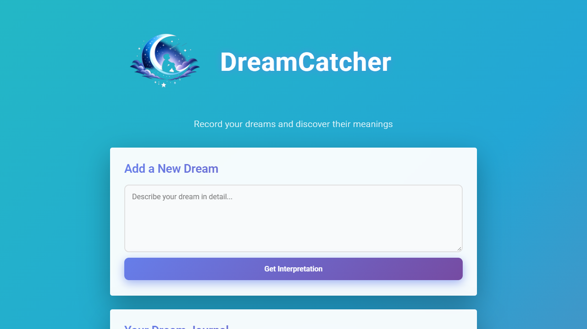
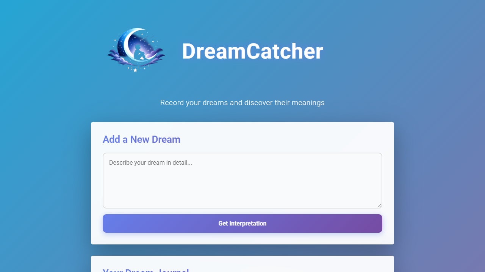

# Dream Catcher walkthrough

Short notes for testing the app locally and deploying a staging copy on Render.

## 1. Test the live app

Open [dream-catcher-github.onrender.com](https://dream-catcher-github.onrender.com/),
enter a dream, and select **Get Interpretation**. The app saves the dream and
shows the generated interpretation below the form.



## 2. Run locally

```powershell
npm install
npm start
```

Open <http://localhost:3001>. Without `DATABASE_URL`, local development uses the
SQLite file configured by `DATABASE_PATH` (or `dreams.db` by default).



## 3. Database and Render

The app uses PostgreSQL whenever `DATABASE_URL` is present. The
[render.yaml](../render.yaml) blueprint defines both services:

- `dream-catcher-db`: PostgreSQL database
- `dream-catcher`: web service connected through `DATABASE_URL`

Create or update the blueprint in Render, add `GEMINI_API_KEY`, and deploy. The
SQLite fallback remains available for local work.

## 4. Staging branch

```powershell
git switch -c staging
git add .
git commit -m "Add PostgreSQL and staging deployment setup"
git push -u origin staging
```

Create a second Render web service using the `staging` branch and the same
PostgreSQL connection pattern. Test it there before merging to `main`.

Current staging URL: <https://dream-catcher-staging-njf7.onrender.com>

Set `DATABASE_URL` to the Render `dream-catcher-db` connection string and add
the same `GEMINI_API_KEY` used by the production service before testing dream
interpretations.

```powershell
git switch main
git merge staging
git push origin main
```
